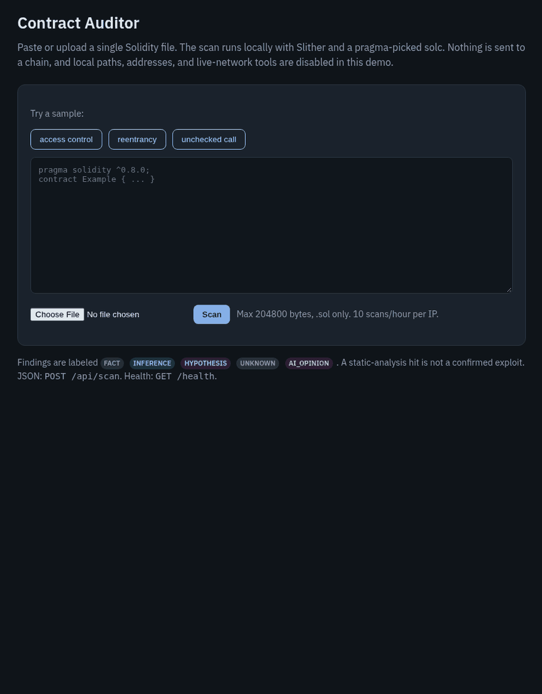
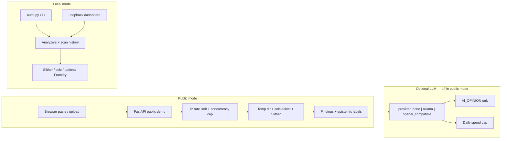

# Contract Auditor

[](https://github.com/Anondevnet/contract-auditor/actions/workflows/ci.yml)

A **local-first Solidity static analyzer**. It runs Slither with a pragma-picked `solc`, groups findings by severity, and labels every claim so a tool hit is never confused with a model opinion. A public demo mode exposes a small paste-or-upload page; the full CLI and loopback dashboard stay on localhost.

This is a defensive auditing tool. It does not send transactions, it does not touch funds, and in public demo mode it never reads a local filesystem path, a chain address, Keychain secrets, or live-network hunt/monitor surfaces.

**Live demo:** [https://contract-auditor-cgw5.onrender.com](https://contract-auditor-cgw5.onrender.com)

It runs on Render's free tier, so it sleeps after a period of inactivity and takes about a minute to wake. You can also run it locally (or in Docker) with the commands below.



*Local Docker run: load the reentrancy sample, scan, and read HIGH findings tagged `FACT`.*

## Note on scope

Public mode only does **static analysis of pasted (or uploaded) Solidity source**. It will not fetch a contract by address, follow an on-chain deployment, open a fork, or run the local research tools. A static-analysis hit is not a confirmed exploit.

## What it is

- **Local mode** (default): the loopback dashboard and CLI (`audit.py scan PATH`, scan-address, history, investigation). Binds `127.0.0.1` only.
- **Public demo mode** (`AUDITOR_MODE=public`): a small page where you paste or upload a single `.sol` file (200 KB cap). Findings are grouped by severity and labeled `FACT` / `INFERENCE` / `HYPOTHESIS` / `UNKNOWN` / `AI_OPINION`. JSON API plus `/health`.
- **Optional AI layer**: an LLM provider (`none`, `ollama`, or `openai_compatible`) can add commentary. In public mode the provider defaults to `none`. Any model output is always labeled `AI_OPINION` and cannot, by itself, mark a finding confirmed.

## Architecture



Public mode does not mount monitor, hunt, discovery, fork/anvil, finrisk, bounty/patch, or price/RPC routes.

## Epistemic labels

| Label | Meaning |
|---|---|
| `FACT` | Directly observed (tool output, source text, a retrieved artifact). |
| `INFERENCE` | A reasoned conclusion from facts, still not a proof. |
| `HYPOTHESIS` | A possible explanation that needs more evidence. |
| `UNKNOWN` | The system does not have the information. |
| `AI_OPINION` | Model-generated text. It cannot, by itself, make a finding `CONFIRMED` or `LIKELY`. |

Severity and confidence are independent of these labels.

## Quick start

### Local mode

```bash
python3 -m venv .venv
source .venv/bin/activate
pip install -r requirements.txt
# system tools: slither, solc-select (Foundry is optional, for the local research path)
python3 audit.py status
python3 audit.py scan path/to/Contract.sol
python3 audit.py dashboard          # http://127.0.0.1:8080
```

### Public demo mode

```bash
export AUDITOR_MODE=public
export AUDITOR_LLM_PROVIDER=none    # default in public mode
python3 audit.py dashboard          # binds 0.0.0.0:8080
# open http://127.0.0.1:8080 and paste or upload a .sol file
```

CLI commands that use a local path, a chain address, monitor, hunt, or a fork refuse to run in public mode.

### Docker

```bash
docker compose up --build
# then open http://127.0.0.1:8080 or POST a sample:
curl -sS -X POST http://127.0.0.1:8080/api/scan \
  -H 'Content-Type: application/json' \
  --data-binary @- <<'EOF'
{"filename":"reentrancy.sol","source":"pragma solidity ^0.8.0; contract InsecureVault { mapping(address=>uint256) public balances; function deposit() external payable { balances[msg.sender]+=msg.value; } function withdraw() external { uint256 a=balances[msg.sender]; (bool ok,)=msg.sender.call{value:a}(""); require(ok); balances[msg.sender]=0; } }"}
EOF
```

The image is `python:3.11-slim` with Slither, solc-select, and a set of solc versions preinstalled, running as a non-root user. Foundry is not included because the demo path does not need it. The process honors `PORT` (default 8080) so the same image can run behind a platform that assigns the listen port.

## Safety limits

- Single `.sol` file, 200 KB size cap, subprocess timeout.
- Per-IP rate limit (default 10 scans/hour) and a global concurrency cap (default 2; 1 is recommended on small hosts).
- Daily token/$ ledger in SQLite; a request that would exceed the cap is refused **before** any HTTP call. Public mode defaults the daily spend cap to $0.
- No Keychain reads, no Etherscan, no RPC, no anvil forks in public mode.
- Structured JSON logs record request id, route, duration, and scan outcome — not source code or secrets.

## Config

`config/default.json` plus environment variables:

| Variable | Role |
|---|---|
| `AUDITOR_MODE` | `local` (default) or `public` |
| `AUDITOR_LLM_PROVIDER` | `none` / `ollama` / `openai_compatible` |
| `AUDITOR_LLM_API_KEY` | Key for `openai_compatible` only; never committed |
| `AUDITOR_LLM_BASE_URL` | OpenAI-compatible base URL |
| `AUDITOR_LLM_MODEL` | Model name |
| `AUDITOR_MAX_UPLOAD_BYTES` | Default 204800 (200 KB) |
| `AUDITOR_RATE_LIMIT_PER_HOUR` | Default 10 scans / IP / hour |
| `AUDITOR_MAX_CONCURRENT_SCANS` | Default 2 |
| `AUDITOR_SCAN_TIMEOUT_SECONDS` | Default 90 |
| `AUDITOR_DAILY_SPEND_USD` | Daily LLM spend cap; **0** in public mode unless you set it |
| `AUDITOR_MAX_OUTPUT_TOKENS` | Per-request output cap (default 1500) |
| `AUDITOR_PUBLIC_DATA_DIR` | Rate-limit + spend SQLite files |
| `AUDITOR_TRUST_X_FORWARDED_FOR` | Set to `1` only behind a trusted proxy |
| `PORT` | Listen port for the dashboard (default 8080) |

Ollama remains the existing loopback-only client. Public mode defaults the provider to `none` even if `default.json` still names an Ollama model.

## Tests and CI

```bash
pip install -r requirements.txt pytest
python -m pytest tests/ -q
```

GitHub Actions runs the full suite on push and pull request (Python 3.11, Slither, solc-select, a matrix of solc versions, pip cache).

## Evaluation

A companion harness scores the auditor (and an optional Slither + LLM triage) against labeled Solidity datasets. Baseline numbers and the scoring code live in the private repo [Anondevnet/auditor-evals](https://github.com/Anondevnet/auditor-evals) (available on request). The public demo does not run that harness.

## Honest limitations

- **Slither-backed.** Public mode is static analysis: compilers plus Slither and a few first-party analyzers. It will miss bugs those tools do not model, and it will report informational or hard-to-exploit findings as well as real issues.
- **The AI layer is optional and off in public mode.** When enabled, model text is `AI_OPINION` only. It is not a second independent verifier.
- **Single-file paste.** Multi-file projects, remappings, and mainnet source fetch are local-mode (or out of scope) features.
- **A green scan is not an audit.** This is a triage aid, not a substitute for review.

## License

No open-source license has been chosen yet; all rights reserved until then.
